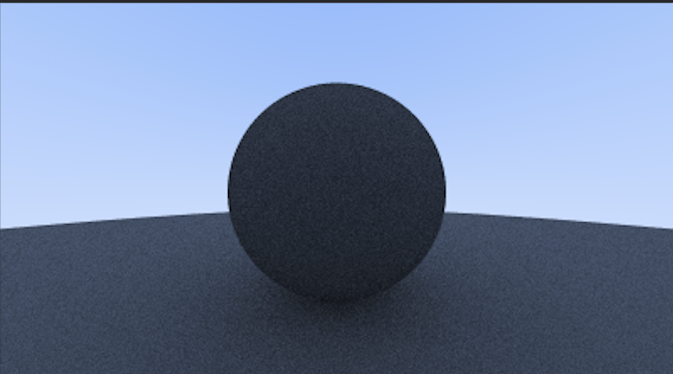

# C++ Ray Tracer

A CPU-based path tracer built in C++ while working through

*Ray Tracing in One Weekend*, then extended with my own

performance optimizations and benchmarking.

progress:

## Overview

This project was my introduction to computer graphics and ray tracing

in C++. I built the core renderer alongside *Ray Tracing in One Weekend*

to understand the mathematics and architecture behind a basic path tracer.

The renderer supports:

- Ray-object intersection

- Surface normals

- Anti-aliasing

- Diffuse, metallic, and dielectric materials

- Reflection and refraction

- Configurable camera and depth of field

- Recursive ray scattering

## How It Works

For every pixel, the camera generates one or more rays into the scene.

Each ray is represented as:

P(t) = O + tD

where:

- O is the ray origin

- D is the ray direction

- t represents distance along the ray

The renderer determines the closest object intersected by each ray,

computes the material interaction at that point, and recursively traces

scattered rays until they hit the environment or reach the maximum

recursion depth.

Multiple samples are averaged per pixel to reduce aliasing and noise.

## Architecture

src/

├── color.h

├── ray.h

├── vec3.h

└── main.cpp

### Core Components

**Ray**

Represents a ray using an origin and direction.

## commands
mkdir -p build &&
clang++ -std=c++17 -x c++ srcs/main -o build/ray-tacer &&
./build/ray-tacer > image.ppm &&
open image.ppm

