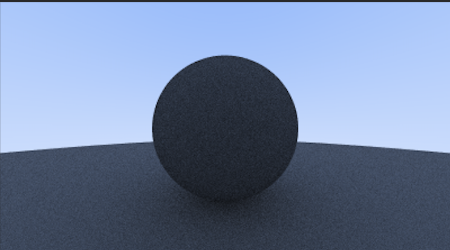

# C++ Ray Tracer

A CPU-based ray tracer built in C++ while working through *Ray Tracing in One Weekend*, extended with multithreaded CPU rendering, deterministic sampling, and a reproducible thread-scaling benchmark.

## Progress



The renderer currently includes:

- Sphere intersections with closest-hit selection across a scene.
- Surface normals oriented against the incoming ray.
- A camera class that handles image setup, ray generation, and rendering.
- Anti-aliasing through random samples within each pixel.
- Recursive diffuse scattering with 50% attenuation at each bounce.
- A sky gradient and plain-text PPM image output.
- Dynamic row scheduling across configurable CPU worker threads.
- Reproducible per-pixel random streams: the same seed produces identical images across thread counts.

The default scene contains a small sphere above a large ground sphere. It renders at **400 × 225 pixels** with **50 samples per pixel**.

## Build and Run

You need a C++17 compiler such as Clang or GCC. There are no external library dependencies.

Change into your `ray-tacer` checkout first (running from another project such as `accrual-app` will fail to find `srcs/main`):

```sh
cd /path/to/ray-tacer
mkdir -p build
clang++ -std=c++17 -O2 -Wall -Wextra -Wpedantic -pthread -x c++ srcs/main -o build/ray-tacer
./build/ray-tacer --threads 4 > image.ppm
```

You can substitute `g++` for `clang++`. The `-x c++` flag is needed because `srcs/main` has no file extension.

Image data goes to standard output; a JSON timing summary goes to standard error. The generated `image.ppm` can be opened in a PPM-compatible image viewer. On macOS:

```sh
open image.ppm
```

## Configure the Render

Command-line settings let you run different configurations without recompiling:

```sh
./build/ray-tacer --threads 8 --width 800 --samples 200 --depth 50 --seed 2027 > image.ppm
./build/ray-tacer --help
```

The default is one thread. Threads are capped at the number of rows. Width, sample count, depth, and thread count must be positive integers. `--no-output` runs the same rendering work without PPM encoding/output.

Edit the camera settings in `srcs/main` before calling `render()`:

```cpp
camera cam;
cam.aspect_ratio = 16.0 / 9.0;
cam.image_width = 400;
cam.samples_per_pix = 50;
cam.render(world);
```

Use a positive image width and aspect ratio, and a positive whole number of samples. Image height is calculated from the width and aspect ratio. More samples reduce noise and smooth edges, but take longer to render.

Add spheres to `world` before rendering:

```cpp
world.add(make_shared<sphere>(point3(0, 0, -1), 0.5));
world.add(make_shared<sphere>(point3(0, -100.5, -1), 100));
```

## How It Works

A ray is represented by `P(t) = O + tD`, where `O` is its origin, `D` is its direction, and `t` is a parameter along the ray. The camera sends rays through randomly selected positions within each pixel.

For each ray, the scene finds the closest sphere intersection within the allowed interval. At a hit, the renderer chooses a diffuse direction using the surface normal plus a random unit vector, traces another ray, and halves the returned colour. Rays that miss the scene return the sky gradient.

The camera averages all samples for a pixel. The colour writer clamps the result and converts it to integer RGB values for the PPM file.

## Project Structure

```text
srcs/
├── main             # Scene construction and camera settings
├── camera.h         # Camera setup, sampling, and recursive rendering
├── hittable.h       # Intersection interface and hit records
├── hittable_list.h  # Scene objects and closest-hit selection
├── sphere.h         # Sphere intersection implementation
├── interval.h       # Numeric bounds and clamping
├── ray.h            # Ray origin, direction, and points along a ray
├── vec3.h           # Vector math and random direction helpers
├── colour.h         # RGB conversion and PPM pixel output
└── utils.h          # Shared constants, random numbers, and includes
```

`srcs/random.h` implements the thread-local sampler. `tests/check_render.py` checks image consistency and argument handling. `benchmarks/benchmark.py` records repeatable measurements.

## Multithreaded CPU Rendering

The renderer first allocates an RGB framebuffer. Each worker claims the next available row using an atomic counter, traces the samples for that row, and writes to its own framebuffer elements. Dynamic scheduling balances rows with different amounts of diffuse scattering. The scene and initialized camera remain read-only while workers run.

The original shared `std::rand()` calls are replaced by a thread-local SplitMix64 sampler. Before each pixel, its state is seeded from the global seed and pixel index. A pixel therefore receives the same random samples regardless of which worker renders it. This avoids shared random-state contention and makes single-threaded and parallel results directly comparable. This sampler is for rendering, not cryptography.

Workers never write to the image stream. After all workers join, the calling thread writes pixels in image order. A single-thread run uses the same worker directly without creating an extra thread. The framebuffer uses roughly 24 bytes per pixel; rendering now buffers the image instead of streaming each pixel as it is computed.

## Tests and Benchmark

```sh
python3 tests/check_render.py build/ray-tacer
clang++ -std=c++17 -O2 -pthread -I srcs tests/check_workers.cpp -o build/check-workers
./build/check-workers
python3 benchmarks/benchmark.py --cpu "YOUR CPU MODEL"
```

The tests compare PPM bytes at 1, 2, 4, and 8 threads, repeat runs, check a non-divisible row count, cap excess workers, check seed changes, and reject invalid settings.

The worker test also verifies exception propagation and cleanup. The rendering integration tests passed with UndefinedBehaviorSanitizer (`-fsanitize=undefined`) on the development machine. AddressSanitizer did not finish startup and ThreadSanitizer reported a runtime interceptor startup error in this environment; neither is claimed as a successful check.

The benchmark renders the same two-sphere scene at 800 x 450, 200 samples/pixel, depth 50, and seed 2027. It first compares full-size image hashes at all thread counts (one warmup each), then performs five timed runs per configuration in shuffled order. Results include raw samples, medians, ranges, compiler flags, and environment details.

Timing uses `std::chrono::steady_clock` and includes camera setup, framebuffer allocation, ray tracing, and thread creation/join. It excludes PPM formatting/output and process startup. This measures thread scaling within the new implementation, not a before/after comparison against the old random-number generator. See [measured results](benchmarks/results.md) and [raw data](benchmarks/results.json). Speedups depend on the scene, hardware, and system load.

An optional CMake 3.20+ build configuration is also supplied (the direct Clang build above was used for validation and benchmarking):

```sh
cmake -S . -B build-cmake -DCMAKE_BUILD_TYPE=Release
cmake --build build-cmake
```

## Work in Progress

Diffuse scattering is implemented directly in the camera's shading function. Separate materials, metallic reflection, dielectric refraction, depth of field, and gamma correction are not implemented yet.

Recursive scattering is limited by `cam.max_depth` (50 by default). Secondary intersections use a small positive lower bound to avoid self-intersections.

## Acknowledgements

The graphics baseline follows Peter Shirley's *Ray Tracing in One Weekend*. The added CPU threading, deterministic per-pixel sampling, command-line configuration, tests, and benchmark harness extend that baseline. The renderer is currently a working diffuse-scattering implementation, not the completed tutorial's full material and camera feature set.
